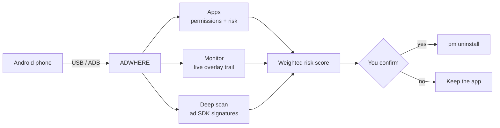

# ADWHERE

**Find the Android app behind the popup ads - and remove it over ADB, from your Linux desktop.**

ADWHERE connects to an Android phone over USB, shows which user-installed apps can draw over other apps, watches the live window stack while you use the phone, reads installed APKs for known ad SDKs, and uninstalls only the package you confirm.


## WEBSITE: https://0xbitx.github.io/Adwhere
---

## Contents

- [What ADWHERE does](#what-adwhere-does)
- [Download](#download)
- [Requirements](#requirements)
- [Quick start](#quick-start)
- [Using ADWHERE](#using-adwhere)
- [How the risk score works](#how-the-risk-score-works)
- [Privacy and safety](#privacy-and-safety)
- [Bundled ADB and cache](#bundled-adb-and-cache)
- [Troubleshooting](#troubleshooting)
- [FAQ](#faq)
- [Disclaimer](#disclaimer)

---

## What ADWHERE does

Popup ads on Android usually do not come from the browser. A sideloaded app draws an overlay above whatever you are doing, waits for the right moment, then opens an ad. By the time you look at the notification shade, the app that caused it is gone.

ADWHERE keeps the evidence:

- Lists user-installed packages and the permissions that matter for popup ads.
- Samples the live window stack and records every app drawing above the foreground app.
- Reads the installed APK and looks for known ad SDK code.
- Combines those signals into a weighted, explainable risk score.
- Removes one package, only after you confirm it.



### At a glance

| Feature | What it gives you |
| --- | --- |
| **Apps** | Every user-installed package with icon, version, installer, permissions and risk score. |
| **Monitor** | A live trail of foreground apps and overlays, sampled every 1.2 seconds. |
| **Deep scan** | APK inspection for 17 known ad SDK families, cached per package version. |
| **Risk score** | A 0–100 score with every contributing reason shown, not a black-box verdict. |
| **Uninstall** | One explicit action, behind a dialog that names the package first. |
| **Bundled ADB** | Google's platform-tools `adb` is embedded; `android-tools` is not required. |

---

## Download

Current release: **ADWHERE 1.0.0** for **Linux x86-64**.

| | |
| --- | --- |
| **Binary** | [`adwhere`](https://github.com/0xbitx/Adwhere/releases/latest/download/adwhere) |
| **Version** | 1.0.0 |
| **Platform** | Linux x86-64 ELF |
| **Size** | 40,618,760 bytes (38.7 MiB) |
| **SHA-256** | `8d9c45441a670c11b7188b513f4383833f4327cceaeaddcc2755f9d793d6ebb5` |
| **Bundled** | Google platform-tools `adb` |
| **Runtime** | glibc 2.38+, GTK 3, WebKitGTK 4.1 |

### Install with curl

The binary is attached to the latest GitHub Release. Download it with:

```bash
curl -fL https://github.com/0xbitx/Adwhere/releases/latest/download/adwhere -o adwhere
chmod +x adwhere
./adwhere
```

`curl -fL` is intentional: `-f` fails on an HTTP error instead of saving an error page, and `-L` follows redirects.

If you also commit the ELF to the repository root, the raw URL is available as an alternative:

```bash
curl -fL https://raw.githubusercontent.com/0xbitx/Adwhere/main/adwhere -o adwhere
```

If the binary is tracked with Git LFS, the raw URL returns an LFS pointer instead of the ELF. Use the release asset URL in that case.

### Verify the binary

Always compare the downloaded file with the published checksum before running it:

```bash
sha256sum adwhere
```

Expected output:

```text
8d9c45441a670c11b7188b513f4383833f4327cceaeaddcc2755f9d793d6ebb5  adwhere
```

Or verify it in one command:

```bash
echo "8d9c45441a670c11b7188b513f4383833f4327cceaeaddcc2755f9d793d6ebb5  adwhere" | sha256sum -c -
```

Expected result:

```text
adwhere: OK
```

The release also includes a `SHA256SUMS` asset if you prefer the standard checksum file:

```bash
curl -fLO https://github.com/0xbitx/Adwhere/releases/latest/download/SHA256SUMS
sha256sum -c SHA256SUMS
```

---

## Requirements

| | |
| --- | --- |
| **Linux** | x86-64, glibc 2.38 or newer (Ubuntu 24.04+, Debian 13+, Fedora 39+, current Arch) |
| **Desktop** | X11 or Wayland, with GTK 3 and WebKitGTK 4.1 |
| **Phone** | Android 8.0 or newer, USB debugging enabled |
| **Cable** | A USB data cable, not a charge-only cable |
| **Privileges** | None on the phone; root is not required |
| **Disk** | About 41 MB for the binary, plus a small cache for icons and scan results |

The binary embeds Google's platform-tools `adb`, so `adb` and `android-tools` do **not** need to be installed. The desktop still needs GTK 3 and WebKitGTK 4.1 for the window:

```bash
# Debian / Ubuntu / Kali
sudo apt install libgtk-3-0 libwebkit2gtk-4.1-0

# Fedora
sudo dnf install gtk3 webkit2gtk4.1

# Arch Linux
sudo pacman -S gtk3 webkit2gtk-4.1
```

Package names vary between distributions. Install the GTK 3 and WebKitGTK 4.1 runtime packages provided by your distribution.

---

## Quick start

1. **Download and verify the binary.**

   ```bash
   curl -fL https://github.com/0xbitx/Adwhere/releases/latest/download/adwhere -o adwhere
   chmod +x adwhere
   sha256sum adwhere
   ```

   Compare the output with the checksum in [Download](#download).

2. **Enable Developer options on the phone.**

   Open **Settings → About phone** and tap **Build number** seven times.

3. **Enable USB debugging.**

   Open **Settings → System → Developer options** and turn on **USB debugging**.

4. **Connect the phone.**

   Plug in the USB cable, unlock the phone, and accept the **Allow USB debugging?** prompt. Tick **Always allow from this computer** if you do not want to see the prompt again.

5. **Start ADWHERE.**

   ```bash
   ./adwhere
   ```

6. **Connect in the app.**

   Press **Connect**. The device panel fills in and the live monitor starts automatically.

7. **Review, then remove.**

   Open **Apps**, review the score order or filter by risk, read the reasons, and uninstall only the package you recognize as adware. A confirmation dialog names the package before anything is removed.

---

## Using ADWHERE

### Overview

Session statistics, the number of popup-capable packages, the riskiest apps in the scan, and the current device state.

### Apps

Every user-installed package, with its icon, version, installer, permissions and weighted risk score. Open a row to see exactly which signals contributed to the score.

- **Scan** lists packages and reads their metadata.
- **Deep scan** reads `classes*.dex` from the installed APK and checks for known ad SDK families.
- **Filter** narrows the list with the **All**, **Popup**, **Internet**, **Risky** and **Detected** scopes.
- **Search** filters by package name or version.
- **Copy package** puts the exact package name on your clipboard.

### Monitor

The monitor samples `dumpsys window` every 1.2 seconds while the phone is in use. It shows:

- The foreground app and its current activity.
- Any other package drawing above it.
- Overlay window types, full-screen coverage and ad-style activity names.
- A recorded trail of up to 200 app events per session.

Rows stay in the trail after the popup closes, so you can attach a name and an icon to the ad you just saw.

### Deep scan

Deep scan reads the APK already installed on the phone and looks for 17 ad SDK families: Google Ads (AdMob), Meta Audience Network, Unity Ads, AppLovin, ironSource, Mintegral, Pangle, Vungle, AdColony, Chartboost, InMobi, StartApp, MoPub, Smaato, Fyber, Tapjoy and Amazon Ads.

Results are cached per package version under `~/.cache/adwhere/adscan`. Signature matching is a strong signal, not proof: an app can contain an ad SDK without showing popup ads, and an app can show ads without a known SDK.

### Uninstall

Uninstall is one explicit action:

1. Select a package from the scanned list.
2. Confirm the package name in the dialog.
3. ADWHERE runs `pm uninstall` for that package.

The package and its local data are deleted permanently. The UI only offers uninstall for packages from the current scan; system apps are not listed. Apps that are device administrators or active accessibility services may refuse removal until you deactivate them in Android settings.

### Keyboard shortcuts

| Key | Action |
| --- | --- |
| `r` | Scan apps |
| `d` | Deep scan |
| `m` | Monitor |
| `u` | Uninstall selected app |
| `/` | Focus the filter |
| `Esc` | Close the open dialog |

---

## How the risk score works

ADWHERE does not treat a single permission as proof. It adds and subtracts weighted reasons, then clamps the result to 0–100. The app detail panel shows every reason and its weight.

| Signal | Weight |
| --- | ---: |
| Overlay above several different apps | +20 |
| Stacked ad SDKs (4 or more) | +20 |
| Can draw over other apps (`SYSTEM_ALERT_WINDOW`) | +16 |
| Multiple ad SDKs (2–3) | +14 |
| Ad-style activity name | +12 |
| Persistent overlays (30+ samples) | +10 |
| Full-screen overlay | +10 |
| Overlay above one other app | +8 |
| No launcher entry | +8 |
| Ad SDK present (1) | +8 |
| Can install other apps (`REQUEST_INSTALL_PACKAGES`) | +7 |
| Has network access (`INTERNET`) | +6 |
| Repeated overlays (10–29 samples) | +6 |
| Old target SDK (below 29) | +6 |
| Starts at boot (`BOOT_COMPLETED`) | +5 |
| Sideloaded package | +5 |
| System overlay window type | +4 |
| Drawing right now | +4 |
| Reads phone state (`READ_PHONE_STATE`) | +3 |
| Sees every installed app (`QUERY_ALL_PACKAGES`) | +3 |
| Overlay observed (3–9 samples) | +3 |
| No ad SDK in the APK | −6 |

| Score | Level |
| --- | --- |
| 65–100 | Critical |
| 45–64 | High |
| 28–44 | Medium |
| 1–27 | Low |
| 0 | No adware signals |

Legitimate apps can match some signals. A launcher, accessibility tool or automation app may legitimately draw overlays and start at boot. Read the package name and the reasons before removing anything.

---

## Privacy and safety

- **Local only.** ADWHERE talks to the local ADB server on `127.0.0.1:5037` and the attached phone. There is no account system, no analytics, no cloud backend and no telemetry.
- **No recording.** ADWHERE reads window metadata, package dumps and APK bytes. It does not capture pixels, audio, notifications or keystrokes.
- **No remote upload.** Icons and deep-scan results are cached on your machine under `~/.cache/adwhere`.
- **Read-only until you confirm.** The only write action on the phone is `pm uninstall` for the package named in the confirmation dialog.
- **Uninstall is permanent.** Removing an app deletes its local data. Back up anything you need first.
- **Verify before running.** Download only from this repository and compare the SHA-256 checksum before executing the binary.

Before removing an app, check that it is not an accessibility service, a launcher, a device administrator or an automation tool you rely on. Only use ADWHERE on a device you own or are authorized to manage, and turn USB debugging off when you are finished.

---

## Bundled ADB and cache

The binary contains a portable `adb` from Google's platform-tools. On first use it is copied to a stable cache path and marked executable:

```text
~/.cache/adwhere/bin/adb-<hash>
```

The cache also holds app icons and deep-scan results:

```text
~/.cache/adwhere/icons/
~/.cache/adwhere/adscan/
```

To reset the cache:

```bash
rm -rf ~/.cache/adwhere
```

To use a different `adb` binary:

```bash
ADWHERE_ADB=/path/to/adb ./adwhere
```

`ADB_BINARY` is accepted as an alias. The override is useful for testing a specific platform-tools version or for debugging a device that the bundled `adb` cannot see.

To confirm that ADWHERE can find and start its embedded `adb`:

```bash
ADWHERE_SELFTEST=1 ./adwhere
```

A healthy build prints something like:

```text
adb: /home/you/.cache/adwhere/bin/adb-7c8042370cb04ad0
source: bundled
server: ok
```

---

## Troubleshooting

| Problem | What to try |
| --- | --- |
| **No device found** | Unlock the phone, use a data cable, enable USB debugging, and accept the authorization prompt. Press **Refresh devices**. |
| **Device shows `unauthorized`** | On the phone, open **Developer options → Revoke USB debugging authorizations**, then replug the cable and accept the prompt again. |
| **Device shows `no permissions`** | Install your distribution's Android udev rules. On Debian/Ubuntu, `sudo apt install android-sdk-platform-tools-common` provides them; then replug the phone. |
| **`Permission denied` when starting** | Make the file executable: `chmod +x adwhere`. |
| **The window does not open** | Install GTK 3 and WebKitGTK 4.1 (see [Requirements](#requirements)). |
| **`GLIBC_2.38 not found`** | The distribution is older than the binary supports. Use Ubuntu 24.04+, Debian 13+, Fedora 39+ or a current rolling release. |
| **App list is empty** | Make sure the phone is unlocked and authorized, then press **Scan** again. Only user-installed packages are listed. |
| **Uninstall fails** | The app may be a device administrator or an active accessibility service. Deactivate it in Android settings, then try again. |
| **Phone disconnects during a scan** | Try another cable or USB port. Some hubs and charge-only cables drop the ADB connection under load. |
| **Monitor shows no overlays** | Keep the phone unlocked and reproduce the popup while the monitor is running. The monitor samples every 1.2 seconds. |
| **Stale icons or scan results** | Close ADWHERE and run `rm -rf ~/.cache/adwhere`, then start it again. |

### Checking the binary itself

```bash
file adwhere
```

A correct download reports a 64-bit x86-64 ELF:

```text
adwhere: ELF 64-bit LSB pie executable, x86-64, version 1 (SYSV), dynamically linked, ...
```

---

## FAQ

**Does ADWHERE need root?**
No. It uses the normal ADB debugging interface.

**Does it install anything on the phone?**
No. It reads package and window metadata over ADB and uninstalls only the package you confirm.

**Does it work over Wi-Fi?**
USB is the supported path. Wireless ADB pairing is not part of the interface and depends on the phone, the network and the Android version.

**Does it collect any data?**
No. There is no account, no analytics, no remote API and no upload. Everything stays on the desktop and the phone.

**Can I use my own `adb`?**
Yes:

```bash
ADWHERE_ADB=/path/to/adb ./adwhere
```

**Does it run on Windows, macOS or ARM?**
No. The published binary is Linux x86-64 only.

**Can I remove system apps?**
No. The scan lists user-installed packages, and the UI only offers uninstall for packages from that list.

**Why is the binary 40 MB?**
It is a self-contained native build. It embeds the Python runtime, pywebview, Pillow, pure-python-adb, tabulate and Google's platform-tools `adb`, so the target machine needs no Python installation and no `android-tools` package.

**Why does the binary need GTK and WebKitGTK?**
The interface is rendered in a native desktop webview. Those libraries provide the window; the app logic and `adb` are inside the binary.

**Is the source code available?**
No. This repository distributes the compiled ELF binary only. Bug reports and false-positive reports are still welcome through the issue tracker.

**Does it need an internet connection?**
No, not after the download. All inspection happens over the local ADB connection; there is no cloud service.

**How do I update ADWHERE?**
Download the new `adwhere`, verify its checksum, and replace the old binary. The cache under `~/.cache/adwhere` can stay; remove it if you want a clean scan.

---

## Disclaimer

ADWHERE is a cleanup tool, not a guarantee. Adware signals can overlap with legitimate apps, and uninstalling an app deletes its local data permanently. Review the package name and the weighted reasons before confirming a removal.

The software is provided as-is, without warranty of any kind. Use it at your own risk.

